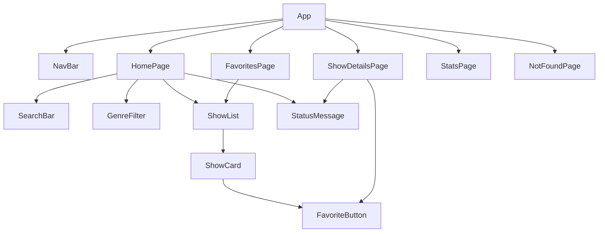

# ארכיטקטורה · TV Shows Explorer

המסמך מתאר איך האפליקציה בנויה: אילו קבצים יש, איך קוראים להם, מה כל אחד עושה, איפה נשמר ה-state, ואיך המידע זורם.
זו התוכנית. כשמשהו משתנה בזמן הבנייה, מעדכנים כאן.

- **API:** [TVmaze](https://www.tvmaze.com/api), חינמי ובלי מפתח.
  - כל הסדרות: `https://api.tvmaze.com/shows` (240 סדרות בבקשה אחת)
  - סדרה אחת: `https://api.tvmaze.com/shows/:id`
- **כלים:** React + Vite + TypeScript, React Router, Vitest, CSS Modules.

## מבנה התיקיות

```
src/
├── main.tsx                  נקודת הכניסה. עוטף את App ב-BrowserRouter
├── App.tsx                   NavBar + הגדרת ה-Routes. קורא ל-useShows ול-useFavorites
├── index.css                 עיצוב גלובלי בלבד: צבעים, גופן, body
├── types/
│   └── show.ts               הטיפוס Show: מה מגיע מה-API
├── data/
│   └── sample-shows.json     סדרות לדוגמה, רק למשימה 1 (לפני ה-API)
├── api/
│   └── tvmaze.ts             fetchShows(), fetchShow(id): הקריאות לרשת, ורק הן
├── hooks/                    custom hooks: כל ה-useEffect של האפליקציה נמצאים כאן
│   ├── useShows.ts           טוען את כל הסדרות  → { shows, isLoading, error }
│   ├── useShow.ts            טוען סדרה אחת לפי id → { show, isLoading, error }
│   └── useFavorites.ts       state של המועדפים + שמירה ל-localStorage
├── utils/
│   ├── shows.ts              לוגיקה טהורה: סינון, סטטיסטיקות, מועדפים
│   └── shows.test.ts         בדיקות Vitest ללוגיקה
├── components/               תיקייה לכל רכיב: קובץ רכיב + קובץ עיצוב
│   ├── NavBar/
│   │   ├── NavBar.tsx
│   │   └── NavBar.module.css
│   ├── ShowList/             (אותו מבנה)
│   ├── ShowCard/
│   ├── SearchBar/
│   ├── GenreFilter/
│   ├── FavoriteButton/
│   └── StatusMessage/        הודעת "טוען..." או הודעת שגיאה
└── pages/                    תיקייה לכל עמוד, באותו מבנה
    ├── HomePage/
    ├── ShowDetailsPage/
    ├── FavoritesPage/
    ├── StatsPage/
    └── NotFoundPage/
```

**החלוקה, בשורה אחת לכל תיקייה:**
- `api/` מדבר עם הרשת.
- `hooks/` מחזיק state ו-`useEffect`.
- `utils/` מחשב.
- `components/` מציג.
- `pages/` מחבר את כולם לעמוד.

הלוגיקה ב-`utils/` לא מכירה את React, ולכן אפשר לבדוק אותה עם Vitest בלי לפתוח דפדפן.

`App.css` ותיקיית `assets/` מהתבנית של Vite יימחקו במשימה 1.

## מוסכמות שמות

**הכלל בקצרה:**
- רכיב React, וכל מה שנקרא על שמו, כותבים ב-**PascalCase**.
- משהו שקוראים לו או שמחזיק ערך כותבים ב-**camelCase**.
- כתובת, או קובץ שהוא לא קוד, כותבים ב-**kebab-case**.
- ערך קבוע כותבים ב-**UPPER_SNAKE_CASE**.

### תיקיות וקבצים

| מה | סגנון | דוגמה |
|---|---|---|
| תיקייה של סוג קבצים | lowercase, ואם יש כמה מילים אז kebab-case | `components/`, `pages/`, `hooks/`, `utils/`, `api/` |
| תיקייה של רכיב או עמוד | PascalCase, בדיוק כמו שם הרכיב | `ShowCard/`, `HomePage/` |
| קובץ רכיב או עמוד | PascalCase | `ShowCard.tsx` |
| קובץ CSS Module | אותו שם כמו הרכיב + `.module.css` | `ShowCard.module.css` |
| קובץ hook | camelCase שמתחיל ב-`use` | `useShows.ts` |
| קובץ לוגיקה או api | camelCase | `shows.ts`, `tvmaze.ts` |
| קובץ טיפוסים | camelCase לפי הנושא, בתוך `types/` | `types/show.ts` |
| קובץ בדיקה | שם הקובץ שנבדק + `.test.ts` | `shows.test.ts` |
| קובץ מידע (JSON) | kebab-case | `sample-shows.json` |

### בתוך הקוד

| מה | סגנון | דוגמה |
|---|---|---|
| רכיב | PascalCase | `ShowCard`, `HomePage` |
| interface או type | PascalCase | `Show`, `ShowCardProps` |
| משתנה | camelCase | `favoriteIds`, `filteredShows` |
| פונקציה | camelCase, מתחילה בפועל | `filterShows()`, `fetchShow()` |
| hook | camelCase שמתחיל ב-`use` | `useShows()` |
| boolean | camelCase עם `is` או `has` | `isLoading`, `isFavorite` |
| setter של state | `set` + שם ה-state | `setShows`, `setIsLoading` |
| prop של אירוע | `on` + מה קרה | `onToggleFavorite`, `onChange` |
| פונקציה בתוך רכיב שמטפלת באירוע | `handle` + מה קרה | `handleSearchChange` |
| קבוע | UPPER_SNAKE_CASE | `API_BASE_URL`, `ALL_GENRES`, `FAVORITES_STORAGE_KEY` |
| class בתוך CSS Module | camelCase | `.showCard`, `.isActive` |
| כתובת (route) | lowercase, kebab-case | `/shows/:id`, `/favorites` |
| מפתח ב-localStorage | kebab-case עם שם האפליקציה | `"tv-shows-explorer:favorites"` |

**למה class ב-CSS Module כותבים ב-camelCase:** משתמשים בו מתוך TypeScript. `styles.showCard` נקרא כמו כל משתנה אחר, ואילו `styles["show-card"]` מכריח סוגריים ומרכאות.

**`on` מול `handle`:** הרכיב שמקבל אירוע מגדיר prop בשם `onToggleFavorite`. הרכיב שמטפל באירוע כותב פונקציה בשם `handleToggleFavorite` ומעביר אותה: `onToggleFavorite={handleToggleFavorite}`.

**יוצאי דופן:**
- `App.tsx`, `main.tsx` ו-`index.css` נשארים בשמות של Vite.
- `README.md`, `PRD.md`, `PROMPTS.md` ו-`tasks.md` נשארים בשמות שנקבעו בהוראות הפרויקט.

## סגנון קוד

**כל פונקציה היא arrow function בתוך `const`.** זה נכון לרכיבים, ל-hooks ולפונקציות הלוגיקה:

```tsx
const ShowCard = ({ show }: ShowCardProps) => {
  return <article>...</article>
}

export default ShowCard
```

```ts
export const filterShows = (shows: Show[], query: string, genre: string): Show[] => {
  ...
}
```

**exports:**
- רכיבים ועמודים משתמשים ב-`export default` בשורה האחרונה של הקובץ, כי בכל קובץ יש רכיב אחד.
- hooks, utils ו-api משתמשים ב-`export const` (named export), כי בקובץ אחד יכולות להיות כמה פונקציות.
- טיפוסים מייבאים עם `import type`: `import type { Show } from '../../types/show'`.

**עיצוב הקוד:**
- גרשיים בודדים (`'...'`), ובלי `;` בסוף שורה, כמו בקבצים ש-Vite יצר.
- arrow function לא זמינה לפני השורה שבה היא מוגדרת, כי אין לה hoisting כמו ל-`function`. לכן מגדירים פונקציה לפני שמשתמשים בה.

## עיצוב עם CSS Modules

לכל רכיב ולכל עמוד יש קובץ `X.module.css` משלו, באותה תיקייה:

```tsx
import styles from './ShowCard.module.css'

<article className={styles.showCard}>...</article>
```

**איך זה עובד:**
- Vite הופך כל class לשם ייחודי. למשל `.showCard` הופך ל-`_showCard_x7f2a`.
- לכן אותו שם class בשני רכיבים לא יתנגש.
- העיצוב של רכיב נמצא ליד הרכיב, ואם מוחקים את הרכיב מוחקים את התיקייה כולה.

**שני כללים:**
- ב-`index.css` נשאר רק עיצוב גלובלי: משתני צבע (`--color-primary`), גופן ו-`body`.
- כל class של רכיב נכתב רק ב-`.module.css` שלו.

## useEffect: איפה ואיך

**הכללים:**
1. **כל ה-`useEffect` נמצאים בתוך `hooks/`.** עמודים ורכיבים לא קוראים ל-`useEffect` ישירות, אלא ל-hook. כך יש מקום אחד לחפש בו כל דבר שקורה "מאחורי הקלעים".
2. **כל effect עושה דבר אחד.** טעינה לחוד ושמירה לחוד.
3. **מערך התלויות כולל כל ערך מבחוץ שה-effect משתמש בו.** אם ה-effect משתמש ב-`id`, אז `[id]`.
4. **ב-effect של fetch יש ניקוי (cleanup).** אם הרכיב יצא מהמסך או שה-id השתנה לפני שהתשובה הגיעה, מתעלמים מהתשובה הישנה.

| hook | מה ה-effect עושה | תלויות | מתי הוא רץ |
|---|---|---|---|
| `useShows` | קורא ל-`fetchShows()` ושומר את התוצאה ב-state | `[]` | פעם אחת, כש-`App` עולה |
| `useShow` | קורא ל-`fetchShow(id)` | `[id]` | בכל פעם שה-id בכתובת משתנה |
| `useFavorites` | קורא ל-`saveFavorites(favoriteIds)` | `[favoriteIds]` | בכל שינוי במועדפים |

**הדפוס של hook שטוען מידע:**

```ts
export const useShows = () => {
  const [shows, setShows] = useState<Show[]>([])
  const [isLoading, setIsLoading] = useState(true)
  const [error, setError] = useState<string | null>(null)

  useEffect(() => {
    let isCancelled = false

    fetchShows()
      .then((data) => { if (!isCancelled) setShows(data) })
      .catch(() => { if (!isCancelled) setError('לא הצלחנו לטעון את הסדרות') })
      .finally(() => { if (!isCancelled) setIsLoading(false) })

    return () => { isCancelled = true }   // cleanup
  }, [])

  return { shows, isLoading, error }
}
```

- `useShow(id)` בנוי באותה צורה, עם `[id]` כתלות.
- ב-`useFavorites` הערך ההתחלתי נטען כך: `useState(() => loadFavorites())`. הפונקציה רצה רק ברינדור הראשון, ולא קוראים ל-localStorage בכל רינדור.
- ב-`npm run dev`, ‏`StrictMode` מריץ כל effect פעמיים כדי לחשוף באגים. בגלל ה-cleanup זה לא מזיק.

## עמודים וכתובות

| כתובת | עמוד | מה המשתמש עושה בו |
|---|---|---|
| `/` | `HomePage` | רואה את כל הסדרות, מחפש לפי שם ומסנן לפי ז'אנר |
| `/shows/:id` | `ShowDetailsPage` | רואה פרטים מלאים: תמונה, ז'אנרים, דירוג, תקציר וימי שידור |
| `/favorites` | `FavoritesPage` | רואה את הסדרות שסימן כמועדפות ומסיר מהן |
| `/stats` | `StatsPage` | רואה כמה סדרות יש בכל ז'אנר, דירוג ממוצע ו-5 הסדרות המובילות |
| `*` | `NotFoundPage` | כתובת שלא קיימת. יש בעמוד קישור חזרה לרשימה |

ה-Routes מוגדרים ב-`App.tsx`. ה-NavBar משתמש ב-`NavLink`, כדי שהעמוד הפעיל יסומן.

## עץ הרכיבים



## איפה נשמר ה-state, ולמה

| state | נוצר ב | נקרא מ | למה דווקא שם |
|---|---|---|---|
| `shows`, `isLoading`, `error` | `useShows` | `App` | שלושה עמודים צריכים את רשימת הסדרות: רשימה, מועדפים וסטטיסטיקות. טוענים אותה פעם אחת ב-App ומעבירים ב-props |
| `favoriteIds` (`number[]`) | `useFavorites` | `App` | הרשימה, עמוד הפרטים ועמוד המועדפים צריכים אותו. נשמר ב-localStorage כדי שלא ייעלם ברענון |
| `query`, `genre` | `useState` רגיל | `HomePage` | רק עמוד הרשימה משתמש בהם |
| `show`, `isLoading`, `error` של סדרה אחת | `useShow(id)` | `ShowDetailsPage` | שייכים רק לעמוד הזה, ומשתנים כשה-id בכתובת משתנה |

**custom hook זה לא state גלובלי.** `useShows()` הוא פונקציה רגילה שמשתמשת ב-`useState` וב-`useEffect`. כל רכיב שקורא לו מקבל עותק משלו, ולכן קוראים לו רק פעם אחת, ב-`App`, ומעבירים את התוצאה ב-props.

**מה לא שומרים ב-state:**
- את הרשימה המסוננת. מחשבים אותה בכל רינדור: `const filteredShows = filterShows(shows, query, genre)`. היא נגזרת מ-state שכבר קיים, ושמירה כפולה עלולה לצאת לא מסונכרנת.
- את הסטטיסטיקות, מאותה סיבה.

## זרימת המידע

### טעינת הרשימה
1. `App` קורא ל-`useShows()`. בתוך ה-hook, `useEffect` עם `[]` (כלומר פעם אחת) קורא ל-`fetchShows()`.
2. בזמן ההמתנה `isLoading = true`, ו-`HomePage` מציג `StatusMessage` עם "טוען...".
3. כשהמידע מגיע, ה-hook קורא ל-`setShows(data)` ול-`setIsLoading(false)`. React מרנדר מחדש, ו-`ShowList` מציג את הכרטיסים עם `map` ו-`key={show.id}`.
4. אם הבקשה נכשלה, `error` מקבל הודעה ומוצג `StatusMessage` של שגיאה.

### מהלחיצה על כרטיס עד שהפרטים מופיעים
1. `ShowCard` עטוף ב-`<Link to={`/shows/${show.id}`}>`.
2. React Router משנה את הכתובת בלי לטעון את הדף מחדש, ומרנדר את `ShowDetailsPage`.
3. `useParams()` מחזיר את ה-`id` מהכתובת. זו מחרוזת, אז ממירים עם `Number(id)`.
4. `useShow(id)`: בתוכו `useEffect` עם `[id]` קורא ל-`fetchShow(id)`. הוא רץ שוב אם ה-id משתנה.
5. מוצגים טוען, שגיאה או הפרטים. התקציר עובר דרך `stripHtml()`, כי TVmaze מחזיר אותו עם תגיות HTML.

### מועדפים
1. `useFavorites()` מאתחל את `favoriteIds` עם `loadFavorites()`, ומחזיר `{ favoriteIds, toggleFavorite }`.
2. `App` מעביר למטה `favoriteIds`, ואת `toggleFavorite` בתור `onToggleFavorite`. הם עוברים ב-props: `HomePage` ← `ShowList` ← `ShowCard` ← `FavoriteButton`.
3. לחיצה על הכפתור קוראת ל-`onToggleFavorite(show.id)`. ה-hook מעדכן: `setFavoriteIds(toggleId(favoriteIds, id))`.
4. בתוך ה-hook, `useEffect` עם `[favoriteIds]` שומר ל-localStorage עם `saveFavorites()`.

## הטיפוסים

```ts
// src/types/show.ts
export interface Show {
  id: number
  name: string
  genres: string[]
  rating: { average: number | null }              // יש סדרות בלי דירוג
  image: { medium: string; original: string } | null
  summary: string | null                          // HTML, למשל "<p>...</p>"
  premiered: string | null
  status: string
  language: string | null
  schedule: { time: string; days: string[] }
}
```

- לכל רכיב יש `interface` בשם `<Component>Props` בתוך קובץ הרכיב. למשל `ShowCardProps`.
- אין `any` בפרויקט. מידע שהמקור שלו לא ידוע, כמו `JSON.parse`, מקבל `unknown` ונבדק לפני השימוש.

## הלוגיקה ב-`utils/shows.ts`

| פונקציה | מה היא מחזירה | איפה משתמשים בה |
|---|---|---|
| `filterShows(shows, query, genre)` | רק הסדרות שמתאימות לחיפוש ולז'אנר | `HomePage` |
| `getGenres(shows)` | כל הז'אנרים, בלי כפילויות ולפי סדר א"ב | `GenreFilter` |
| `stripHtml(html)` | טקסט בלי תגיות | `ShowDetailsPage` |
| `countByGenre(shows)` | `{ Drama: 154, ... }` | `StatsPage` |
| `averageRating(shows)` | ממוצע שמתעלם מ-`null` | `StatsPage` |
| `topRated(shows, count)` | `count` הסדרות עם הדירוג הגבוה ביותר, בלי לשנות את המקור | `StatsPage` |
| `toggleId(ids, id)` | מערך חדש, עם ה-id או בלעדיו | `useFavorites` |
| `loadFavorites()` / `saveFavorites(ids)` | קריאה וכתיבה ל-localStorage | `useFavorites` |

כל הפונקציות מחזירות ערך חדש ולא משנות את מה שקיבלו. זה מה ש-React צריך כדי לזהות שינוי ב-state.

## בדיקות

`src/utils/shows.test.ts` בודק את הלוגיקה ולא את התצוגה:
- `filterShows`: מחזירה הכול כשהחיפוש ריק, לא רגישה לאותיות גדולות וקטנות, ומשלבת שם וז'אנר.
- `stripHtml`: מורידה תגיות, ומחזירה `""` עבור `null`.
- `averageRating`: מתעלמת מ-`null`, ומחזירה `null` לרשימה ריקה.
- `topRated`: הסדר נכון, והמערך המקורי לא משתנה.
- `toggleId`: מוסיפה, מסירה ולא משנה את המערך המקורי.

מריצים עם `npm test`, ובדפדפן עם `npm run test:ui`.

## סדר הבנייה, ואילו קבצים כל משימה נוגעת

| משימה | קבצים עיקריים |
|---|---|
| 1. רשימה מ-JSON מקומי | `types/show.ts`, `data/sample-shows.json`, `ShowList/`, `ShowCard/`, `HomePage/` |
| 2. ניתוב | `main.tsx`, `App.tsx`, `NavBar/`, `ShowDetailsPage/`, `NotFoundPage/` |
| 3. fetch אמיתי, טעינה ושגיאה | `api/tvmaze.ts`, `hooks/useShows.ts`, `hooks/useShow.ts`, `StatusMessage/` |
| 4. Vitest | `utils/shows.ts`, `utils/shows.test.ts`, `package.json` (`test`, `test:ui`) |
| 5. חיפוש וסינון | `SearchBar/`, `GenreFilter/`, `HomePage/` |
| 6. עמוד פרטים מלא | `ShowDetailsPage/`, `stripHtml` |
| 7–8. מועדפים | `hooks/useFavorites.ts`, `FavoriteButton/`, `App.tsx`, `FavoritesPage/` |
| 9. סטטיסטיקות | `StatsPage/`, `countByGenre`, `averageRating`, `topRated` |
| 10. עיצוב ומסך צר | כל קבצי `.module.css`, `index.css` |
| 11. README | `README.md` |
