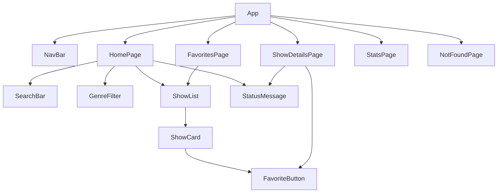

# ארכיטקטורה · TV Shows Explorer

המסמך מתאר איך האפליקציה בנויה: אילו קבצים יש, מה כל אחד עושה, איפה נשמר ה-state, ואיך המידע זורם.
זו התוכנית. כשמשהו משתנה בזמן הבנייה, מעדכנים כאן.

- **API:** [TVmaze](https://www.tvmaze.com/api), חינמי ובלי מפתח.
  - כל הסדרות: `https://api.tvmaze.com/shows` (240 סדרות בבקשה אחת)
  - סדרה אחת: `https://api.tvmaze.com/shows/:id`
- **כלים:** React + Vite + TypeScript, React Router, Vitest.

## מבנה התיקיות

```
src/
├── main.tsx              נקודת הכניסה. עוטף את App ב-BrowserRouter
├── App.tsx               NavBar + הגדרת ה-Routes + ה-state המשותף (סדרות, מועדפים)
├── types.ts              הטיפוס Show: מה מגיע מה-API
├── data/
│   └── sample-shows.json 5 סדרות לדוגמה, רק למשימה 1 (לפני ה-API)
├── api/
│   └── tvmaze.ts         fetchShows(), fetchShow(id): הקריאות לרשת, ורק הן
├── utils/
│   ├── shows.ts          לוגיקה טהורה: סינון, סטטיסטיקות, מועדפים
│   └── shows.test.ts     בדיקות Vitest ללוגיקה
├── components/           רכיבים קטנים שמקבלים הכול ב-props
│   ├── NavBar.tsx
│   ├── ShowList.tsx
│   ├── ShowCard.tsx
│   ├── SearchBar.tsx
│   ├── GenreFilter.tsx
│   ├── FavoriteButton.tsx
│   └── StatusMessage.tsx  הודעת "טוען..." או הודעת שגיאה
└── pages/                עמוד אחד לכל כתובת
    ├── HomePage.tsx
    ├── ShowDetailsPage.tsx
    ├── FavoritesPage.tsx
    ├── StatsPage.tsx
    └── NotFoundPage.tsx
```

**החלוקה, בשורה אחת לכל תיקייה:**
- `api/` מדבר עם הרשת.
- `utils/` מחשב.
- `components/` מציג.
- `pages/` מחבר את כולם לעמוד.

הלוגיקה ב-`utils/` לא מכירה את React, ולכן אפשר לבדוק אותה עם Vitest בלי לפתוח דפדפן.

## עמודים וכתובות

| כתובת | עמוד | מה המשתמש עושה בו |
|---|---|---|
| `/` | `HomePage` | רואה את כל הסדרות, מחפש לפי שם ומסנן לפי ז'אנר |
| `/shows/:id` | `ShowDetailsPage` | רואה פרטים מלאים: תמונה, ז'אנרים, דירוג, תקציר וימי שידור |
| `/favorites` | `FavoritesPage` | רואה את הסדרות שסימן כמועדפות ומסיר מהן |
| `/stats` | `StatsPage` | רואה כמה סדרות יש בכל ז'אנר, דירוג ממוצע ו-5 הסדרות המובילות |
| `*` | `NotFoundPage` | כתובת שלא קיימת. יש בעמוד קישור חזרה לרשימה |

ה-Routes מוגדרים ב-`App.tsx`. ה-NavBar משתמש ב-`NavLink`, כדי שהעמוד הפעיל יסומן.

## עץ הרכיבים



## איפה נשמר ה-state, ולמה

| state | איפה | למה דווקא שם |
|---|---|---|
| `shows`, `loading`, `error` | `App` | שלושה עמודים צריכים את רשימת הסדרות: רשימה, מועדפים וסטטיסטיקות. טוענים אותה פעם אחת ומעבירים ב-props |
| `favoriteIds` (`number[]`) | `App` | הרשימה, עמוד הפרטים ועמוד המועדפים צריכים אותו. נשמר ב-localStorage כדי שלא ייעלם ברענון |
| `query`, `genre` | `HomePage` | רק עמוד הרשימה משתמש בהם |
| `show`, `loading`, `error` של סדרה אחת | `ShowDetailsPage` | שייכים רק לעמוד הזה, ומשתנים כשה-id בכתובת משתנה |

**מה לא שומרים ב-state:**
- את הרשימה המסוננת. מחשבים אותה בכל רינדור: `filterShows(shows, query, genre)`. היא נגזרת מ-state שכבר קיים, ושמירה כפולה עלולה לצאת לא מסונכרנת.
- את הסטטיסטיקות, מאותה סיבה.

## זרימת המידע

### טעינת הרשימה
1. `App` עולה. ה-`useEffect` (עם `[]`, כלומר פעם אחת) קורא ל-`fetchShows()`.
2. בזמן ההמתנה `loading = true`, ו-`HomePage` מציג `StatusMessage` עם "טוען...".
3. כשהמידע מגיע: `setShows(data)` ו-`setLoading(false)`. React מרנדר מחדש, ו-`ShowList` מציג את הכרטיסים עם `map` ו-`key={show.id}`.
4. אם הבקשה נכשלה, `error` מקבל הודעה ומוצג `StatusMessage` של שגיאה.

### מהלחיצה על כרטיס עד שהפרטים מופיעים
1. `ShowCard` עטוף ב-`<Link to={`/shows/${show.id}`}>`.
2. React Router משנה את הכתובת בלי לטעון את הדף מחדש, ומרנדר את `ShowDetailsPage`.
3. `useParams()` מחזיר את ה-`id` מהכתובת. זו מחרוזת, אז ממירים עם `Number(id)`.
4. `useEffect` עם `[id]` קורא ל-`fetchShow(id)`. הוא רץ שוב אם ה-id משתנה.
5. מוצגים טוען, שגיאה או הפרטים. התקציר עובר דרך `stripHtml()`, כי TVmaze מחזיר אותו עם תגיות HTML.

### מועדפים
1. `App` מאתחל את `favoriteIds` עם `loadFavorites()`.
2. `App` מעביר למטה `favoriteIds` ואת הפונקציה `onToggleFavorite(id)`. היא עוברת ב-props: `HomePage` ← `ShowList` ← `ShowCard` ← `FavoriteButton`.
3. לחיצה על הכפתור קוראת ל-`onToggleFavorite`, ו-`App` מעדכן: `setFavoriteIds(toggleFavorite(favoriteIds, id))`.
4. `useEffect` עם `[favoriteIds]` שומר ל-localStorage עם `saveFavorites()`.

## הטיפוסים

```ts
// src/types.ts
export interface Show {
  id: number;
  name: string;
  genres: string[];
  rating: { average: number | null };              // יש סדרות בלי דירוג
  image: { medium: string; original: string } | null;
  summary: string | null;                          // HTML, למשל "<p>...</p>"
  premiered: string | null;
  status: string;
  language: string | null;
  schedule: { time: string; days: string[] };
}
```

- לכל רכיב יש `interface` משלו ל-props. למשל `ShowCardProps`.
- אין `any` בפרויקט. מידע שהמקור שלו לא ידוע, כמו `JSON.parse`, מקבל `unknown` ונבדק לפני השימוש.

## הלוגיקה ב-`utils/shows.ts`

| פונקציה | מה היא מחזירה | איפה משתמשים בה |
|---|---|---|
| `filterShows(shows, query, genre)` | רק הסדרות שמתאימות לחיפוש ולז'אנר | `HomePage` |
| `getGenres(shows)` | כל הז'אנרים, בלי כפילויות ולפי סדר א"ב | `GenreFilter` |
| `stripHtml(html)` | טקסט בלי תגיות | `ShowDetailsPage` |
| `countByGenre(shows)` | `{ Drama: 154, ... }` | `StatsPage` |
| `averageRating(shows)` | ממוצע שמתעלם מ-`null` | `StatsPage` |
| `topRated(shows, n)` | n הסדרות עם הדירוג הגבוה ביותר, בלי לשנות את המקור | `StatsPage` |
| `toggleFavorite(ids, id)` | מערך חדש, עם ה-id או בלעדיו | `App` |
| `loadFavorites()` / `saveFavorites(ids)` | קריאה וכתיבה ל-localStorage | `App` |

כל הפונקציות מחזירות ערך חדש ולא משנות את מה שקיבלו. זה מה ש-React צריך כדי לזהות שינוי ב-state.

## בדיקות

`src/utils/shows.test.ts` בודק את הלוגיקה ולא את התצוגה:
- `filterShows`: מחזירה הכול כשהחיפוש ריק, לא רגישה לאותיות גדולות וקטנות, ומשלבת שם וז'אנר.
- `stripHtml`: מורידה תגיות, ומחזירה `""` עבור `null`.
- `averageRating`: מתעלמת מ-`null`, ומחזירה `null` לרשימה ריקה.
- `topRated`: הסדר נכון, והמערך המקורי לא משתנה.
- `toggleFavorite`: מוסיפה, מסירה ולא משנה את המערך המקורי.

מריצים עם `npm test`, ובדפדפן עם `npm run test:ui`.

## סדר הבנייה, ואילו קבצים כל משימה נוגעת

| משימה | קבצים עיקריים |
|---|---|
| 1. רשימה מ-JSON מקומי | `types.ts`, `data/sample-shows.json`, `ShowList`, `ShowCard`, `HomePage` |
| 2. ניתוב | `main.tsx`, `App.tsx`, `NavBar`, `ShowDetailsPage` |
| 3. fetch אמיתי, טעינה ושגיאה | `api/tvmaze.ts`, `App.tsx`, `StatusMessage` |
| 4. Vitest | `utils/shows.ts`, `utils/shows.test.ts`, `package.json` (`test`, `test:ui`) |
| 5. חיפוש וסינון | `SearchBar`, `GenreFilter`, `HomePage` |
| 6. עמוד פרטים מלא | `ShowDetailsPage`, `stripHtml` |
| 7–8. מועדפים | `FavoriteButton`, `App.tsx`, `FavoritesPage` |
| 9. סטטיסטיקות | `StatsPage`, `countByGenre`, `averageRating`, `topRated` |
| 10. עיצוב ומסך צר | `index.css`, `App.css` |
| 11. 404 ו-README | `NotFoundPage`, `README.md` |
